<div align="center">


# MT Alchemy

**Made to Thrive** · A people-development platform: corporate website, learning portal, online store and role-based workspaces.


[](https://github.com/sayyadsuzain9001/MT-Alchemy/actions/workflows/deploy.yml)


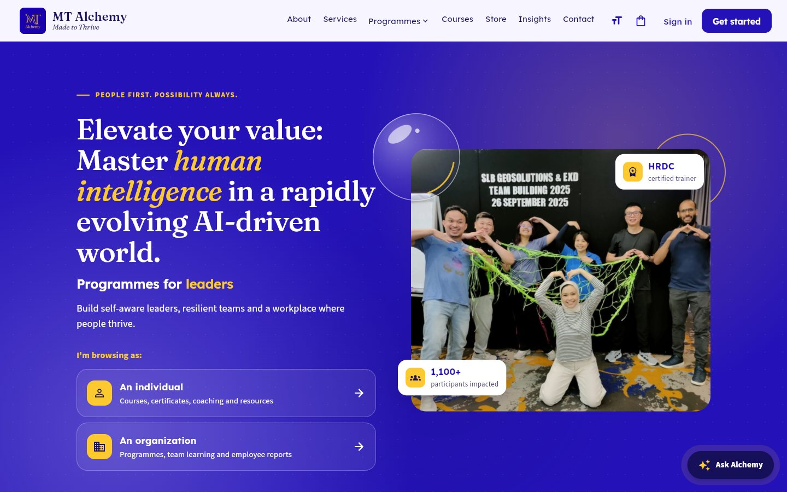

**[Live site](https://sayyadsuzain9001.github.io/MT-Alchemy/)** · **[Course mirror](https://kaedae-mt-alchemy.github.io/group8/)** · **[Setup guide](SETUP.md)** · **[What's new](docs/FINAL_UPDATE.md)**

</div>

> [!IMPORTANT]
> **Cloning this project?** Read **[SETUP.md](SETUP.md)** first. It explains every API key (Firebase, Gemini, Stripe), which domains to authorize, and which names to change before deploying under your own account. Never commit `config/app_env.json` or `payments_server/.env`; both are git-ignored.

> [!TIP]
> **Just want to look around?** Open the [live site](https://sayyadsuzain9001.github.io/MT-Alchemy/), choose **Sign in**, and tap one of the demo-account chips (Learner, Trainer, Employer or Admin).

---

## Table of contents

- [About](#about)
- [What's new](#whats-new)
- [Features](#features)
- [Screenshots](#screenshots)
- [Tech stack](#tech-stack)
- [User roles](#user-roles)
- [User journeys](#user-journeys)
- [Courses, lessons and quizzes](#courses-lessons-and-quizzes)
- [Editing the website (super admin)](#editing-the-website-super-admin)
- [Invoices and receipts](#invoices-and-receipts)
- [Getting started](#getting-started)
- [Configuration](#configuration)
- [Deploy with GitHub Actions](#deploy-with-github-actions)
- [Payments with Stripe](#payments-with-stripe)
- [AI assistant](#ai-assistant)
- [Data model and security](#data-model-and-security)
- [Testing](#testing)
- [Project structure](#project-structure)
- [Documentation](#documentation)
- [Setup guide (API keys and deployment)](SETUP.md)
- [Credits](#credits)

## About

MT Alchemy is a people-development consultancy specialising in emotional intelligence, mindfulness, leadership, team effectiveness and workplace well-being. This Flutter web application brings its services online in one platform:

- a **corporate website** for individuals and organizations,
- a **Learning Management System** with lessons, quizzes and QR-verifiable certificates,
- an **e-commerce store** for digital and physical products,
- **workspaces** for learners, employers, trainers and administrators,
- an **AI assistant** that answers questions about courses, services and the store.

## What's new

> [!NOTE]
> Full release notes are in **[docs/FINAL_UPDATE.md](docs/FINAL_UPDATE.md)**.

| Update | What it means |
| --- | --- |
| 🎓 **Real course content** | All 8 courses now have 16 lessons each across 5 modules: a welcome video, a TED/YouTube talk per module, reading notes, slides (PPTX), a workbook and action plan (PDF), a reflection worksheet (DOCX) and further reading. |
| 📝 **Proper quizzes** | 8 questions per course mixing multiple choice, select-all, true/false and short answer, each with an explanation on the results page. |
| 🛠️ **Lessons & quiz builder** | Admins and trainers add, edit, reorder and delete modules, lessons and questions, and upload PDF, PPT/PPTX, DOC/DOCX or MP4 files (up to 10 MB) or paste YouTube, MP4 and web links. |
| 🖼️ **Editable website** | A super admin can change every photo and text on the public site straight from the page ("Edit this page"), and the change is live for every visitor. |
| 🧭 **A page per programme** | "Explore programme" opens that programme's own page (`/programme/<name>`) in one click. |
| 🧾 **Invoices and receipts** | Every order has a branded PDF invoice, which becomes a receipt once paid, with Download and Print buttons. |
| ✍️ **New wordmark** | "MT Alchemy · *Made to Thrive*" set in Fraunces across the header, menu and footer. |

## Features

| Area | Highlights |
| --- | --- |
| Website | Separate homepages for individuals and organizations, services, coaching, corporate programmes with brochure PDFs, impact stories, insights, contact form |
| Learning | Course catalogue with Draft / Published / Archived status, paid enrolment, **course player for video, PDF, slides, documents, readings and links**, mixed-type quizzes with explanations and pass marks, trainer feedback, certificates with QR verification |
| Store | Digital and physical products, cart, checkout with shipping, Stripe Checkout, bank transfer with receipt upload, order tracking, digital library, **PDF invoices and receipts** |
| Employers | Bulk employee invites and course assignment from Excel/CSV, course seat purchases, progress charts by department, CSV/PDF reports, quotation requests |
| Trainers | Review quiz submissions, give feedback, follow learner progress, create and edit courses |
| Admins | Users and roles, organizations, **Lessons & quiz builder with file uploads**, products and stock, orders and payments, quotes, enquiries, revenue and order charts, **on-page editing of every website photo and text** |
| Everyone | Profiles with photo, in-app notifications, Gemini-powered assistant, responsive layout for desktop, tablet and phone |

## Screenshots

| Learner dashboard | Employer dashboard |
| --- | --- |
| 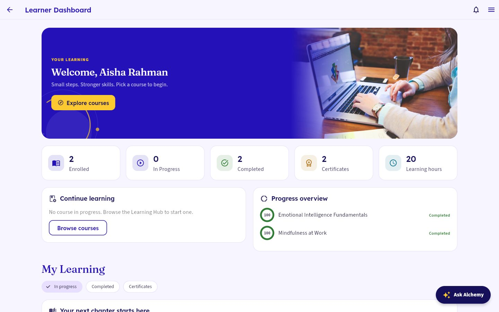 | 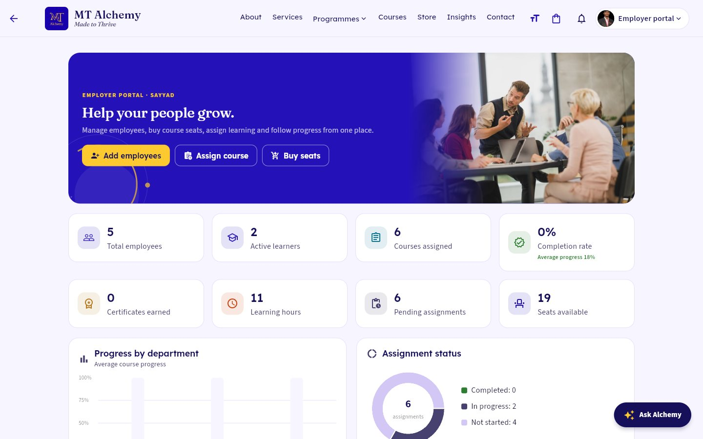 |
| **Admin dashboard** | **Trainer dashboard** |
| 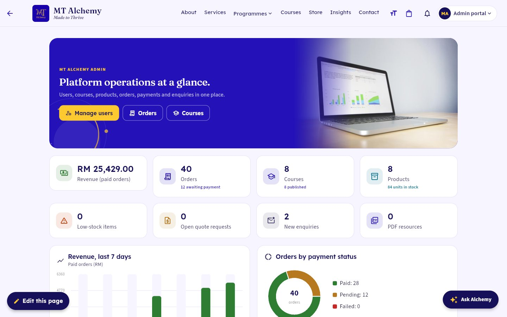 | 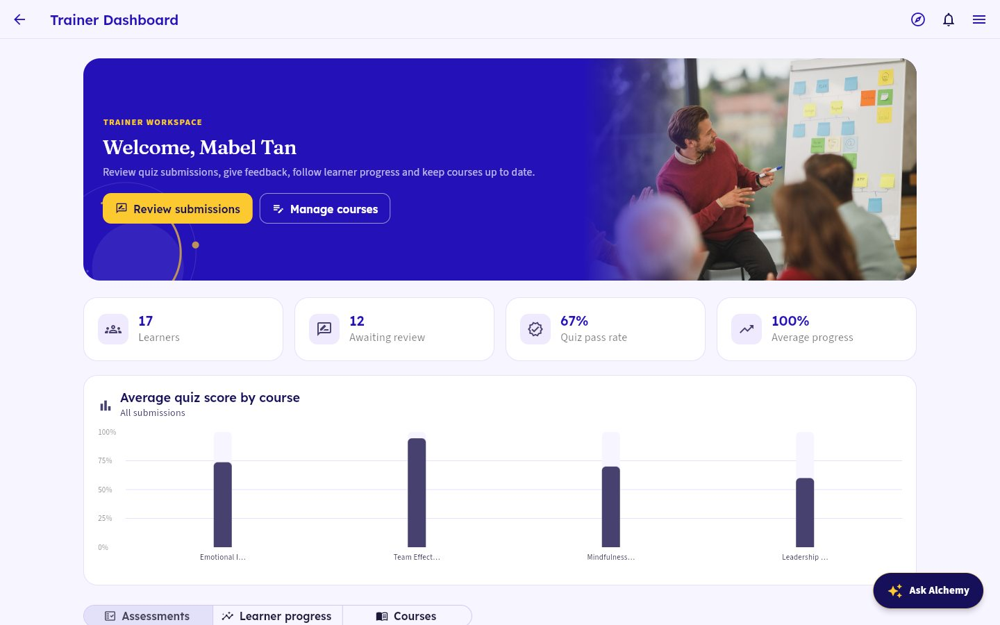 |
| **Certificate with QR verification** | **Stripe payment confirmed** |
|  | 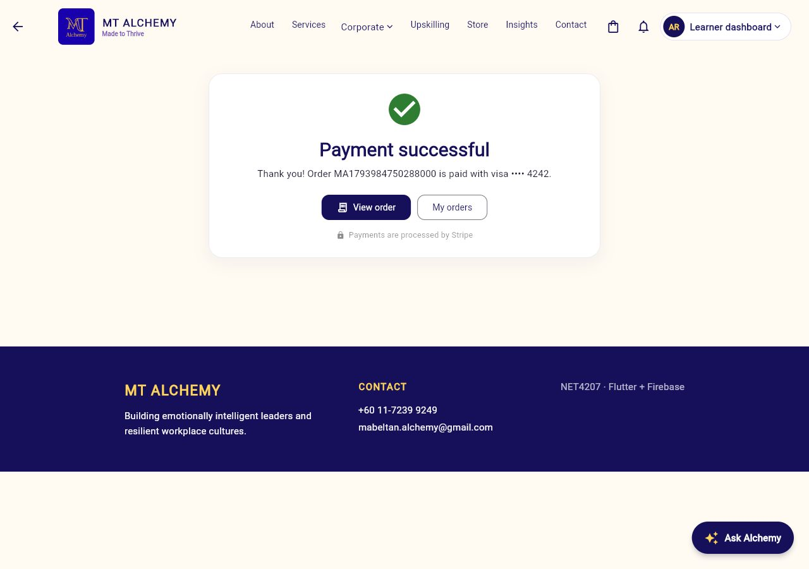 |
| **Course player: slides** | **Course player: PDF workbook** |
| 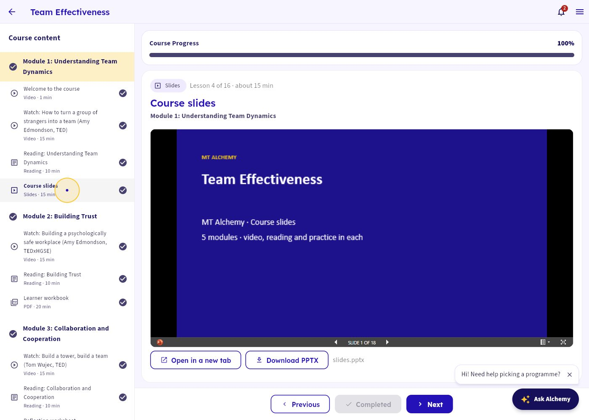 | 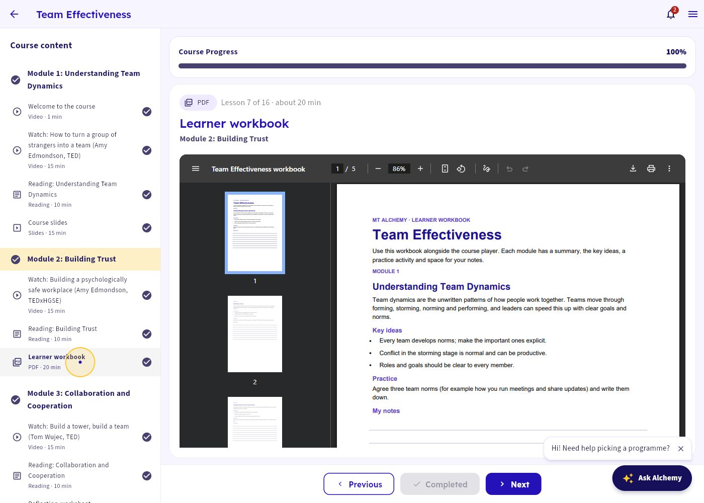 |
| **Lessons & quiz builder (admin)** | **Receipt PDF** |
|  | 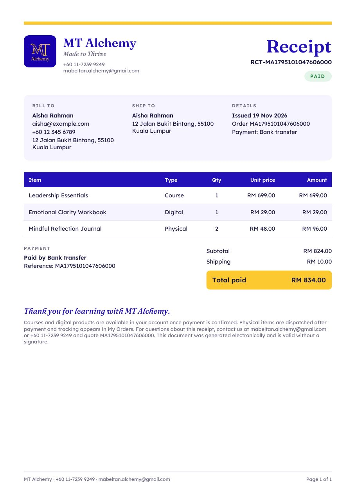 |
| **Programme page** | **Edit this page (super admin)** |
| 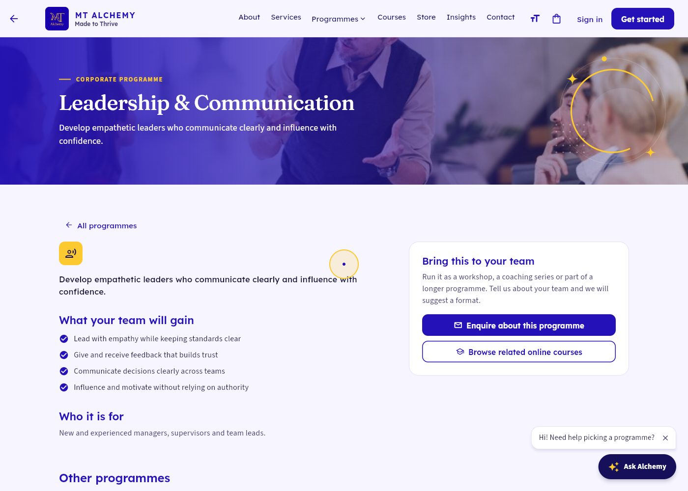 | 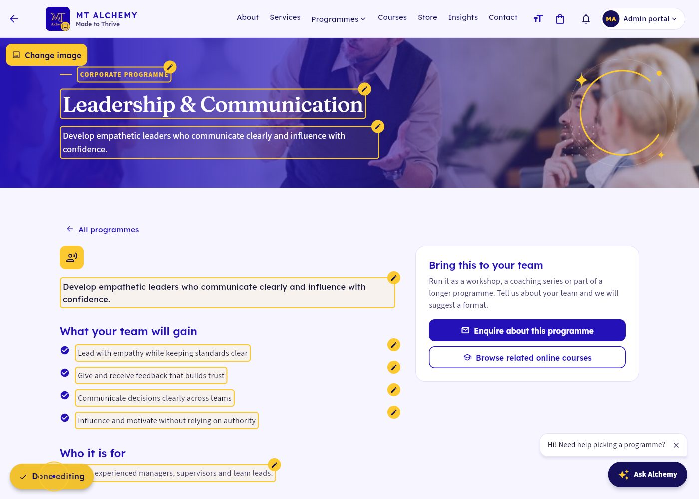 |
| **Alchemy Assistant (Gemini)** | **Homepage sections** |
| 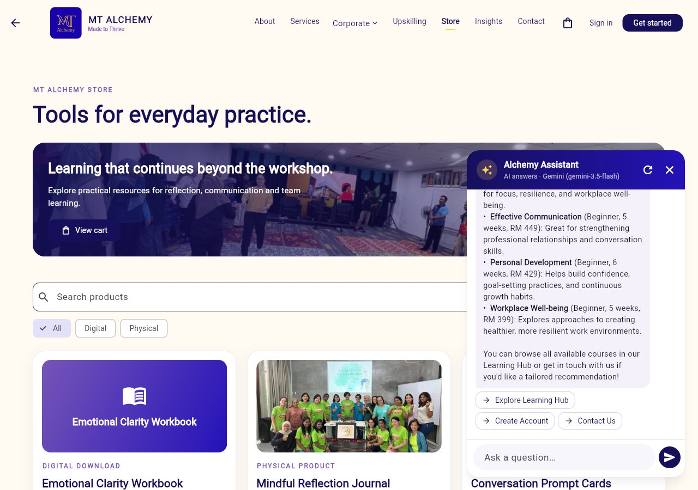 | 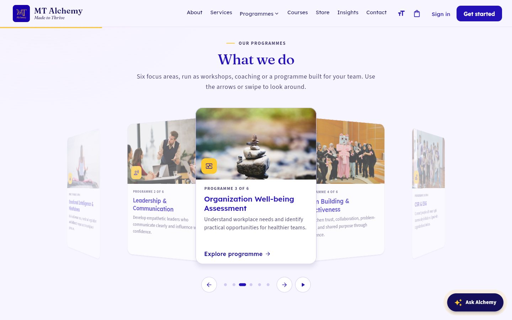 |

<details>
<summary>Phone layout</summary>

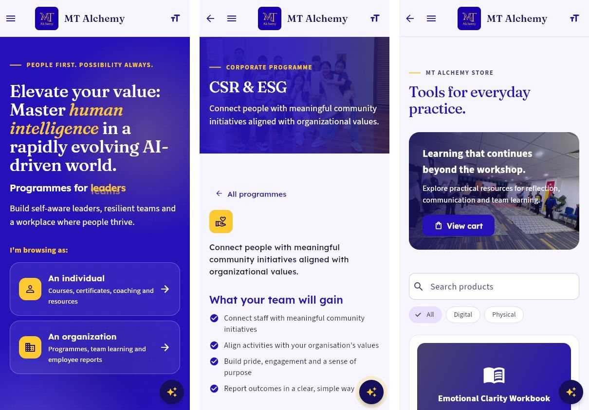

</details>

## Tech stack

| Layer | Technology |
| --- | --- |
| App | Flutter (web, also builds for Android, iOS and desktop) |
| Authentication | Firebase Authentication (email and password) |
| Database | Cloud Firestore with live listeners and role-based security rules |
| Payments | Stripe Checkout through a small Node.js payment server (`payments_server/`) |
| AI | Google Gemini 3.5 Flash, with fallback to Gemini 3.1 Flash-Lite and built-in answers |
| Charts | fl_chart |
| Testing | flutter_test with an in-memory Firestore, Playwright end-to-end scripts |

## User roles

| Role | How the account is created | What they can do |
| --- | --- | --- |
| Visitor | No account | Browse the site, courses and store, add to cart, send an enquiry, chat with the assistant |
| Learner | Self-registration (Individual) | Buy courses, learn, take quizzes, earn certificates, shop, view orders and digital products |
| Employer | Self-registration (Organization) | Manage employees, buy course seats, assign courses, view reports, request quotes |
| Trainer | Created by an admin | Review quizzes, give feedback, follow learners, manage courses |
| Admin | Created by an admin | Full access: users, organizations, courses, products, orders, quotes, enquiries |

Only Learner and Employer accounts can be self-registered. Security rules prevent anyone from giving themselves the Trainer or Admin role.

<details>
<summary>Demo accounts (created by the seed script)</summary>

| Role | Email | Password |
| --- | --- | --- |
| Learner | learner@mtalchemy.demo | AlchemyLearner!26 |
| Trainer | trainer@mtalchemy.demo | AlchemyTrainer!26 |
| Employer | employer@mtalchemy.demo | AlchemyEmployer!26 |
| Admin | admin@mtalchemy.demo | AlchemyAdmin!26 |

The sign-in page shows one-tap chips for these accounts. Hide them with `SHOW_DEMO_ACCOUNTS=false`.

</details>

## User journeys

| Journey | Flow |
| --- | --- |
| **A. Individual learning** | Register → browse courses → pay → enrol → lessons → quiz → certificate (QR verified) |
| **B. Digital product** | Store → digital item → cart → checkout → payment → My Digital Products → download |
| **C. Physical product** | Store → cart → shipping address → payment → admin processes → Shipped → Delivered |
| **D. Employer** | Register organization → invite employees → buy seats → assign courses → employees learn → report |
| **E. Corporate enquiry** | Organizations → enquiry → admin inbox → consultation and quotation |

All five journeys are covered by automated browser tests in `e2e/`.

## Courses, lessons and quizzes

Every course is made of **modules**, each module holds **lessons**, and the course ends with a **quiz**.

| Lesson type | Learners see | Admins can add |
| --- | --- | --- |
| 🎬 Video | YouTube player or a built-in MP4 player | YouTube link, MP4 link or an uploaded MP4/WebM file |
| 📄 PDF | The PDF inline, with Open and Download | Uploaded PDF or a link |
| 📊 Slides | PowerPoint shown inline (Microsoft viewer), with Download | Uploaded PPT/PPTX or a link |
| 📝 Document | Word document shown inline or as a download | Uploaded DOC/DOCX or a link |
| 📖 Reading | Formatted notes with key ideas and a practice task | Text written in the builder |
| 🔗 Link | A card that opens the article | Any web address |

**Quiz question types:** multiple choice, select all that apply, true or false, and short answer (accepted keywords, not case-sensitive). Each question can have an explanation that learners see after submitting.

> [!IMPORTANT]
> A certificate is issued only when the learner has completed **every lesson** and scored at least the course's **pass mark** (60% by default).

**Managing content:** Admin portal → **Courses** → **Lessons & quiz**. Upload files up to **10 MB**; for longer videos, upload to YouTube and paste the link. Uploaded files are stored in Firestore in 900 KB chunks (`lessonFiles`), so no Firebase Storage bucket is needed.

<details>
<summary>Built-in sample content and how to regenerate it</summary>

The sample lessons, quizzes and files come from [`tool/course_content/content.py`](tool/course_content/content.py). After editing it, run:

```powershell
pip install python-docx python-pptx reportlab
python tool/course_content/build_course_content.py
```

This rebuilds the slides, workbooks, worksheets, action plans and welcome videos in `assets/materials/` (the videos need `ffmpeg`) and the generated `lib/data/course_seed_content.dart`. Courses saved in the database without lessons fall back to this content automatically, and older courses with the previous quiz format keep working.

</details>

## Editing the website (super admin)

Signed in as an admin, open any public page and press **Edit this page**:

- **Change image** on any photo: pick from the photo library, upload your own (compressed automatically) or paste a link.
- **Pencil** on any heading or paragraph to rewrite it.
- **Reset to original** puts the built-in photo or text back.

Changes are saved in Firestore (`siteContent`, `siteImages`) and appear for every visitor immediately. The **Website content** page in the admin portal lists every change in one place.

## Invoices and receipts

Every order has a professional A4 PDF with the MT Alchemy logo and contact details, bill-to and ship-to, an item table (course, digital or physical), subtotal, shipping, total in RM, payment method and reference.

- Unpaid orders give an **Invoice** (`INV-<order number>`); once paid it becomes a **Receipt** (`RCT-<order number>`).
- **Download** and **Print** buttons appear on the order confirmation, order details, My Orders and admin Orders pages.

> [!NOTE]
> The document is an order invoice or receipt. It does not carry tax or company registration numbers.

## Getting started

### Prerequisites

- [Flutter](https://docs.flutter.dev/get-started/install) 3.35 or newer
- [Node.js](https://nodejs.org) 18 or newer
- Firebase CLI: `npm install -g firebase-tools`
- Java 21 or newer (only for the local Firebase emulators)

### Quick start with local emulators (no cloud project needed)

```powershell
git clone https://github.com/sayyadsuzain9001/MT-Alchemy.git
cd MT-Alchemy
flutter pub get
powershell -ExecutionPolicy Bypass -File tool\dev.ps1
```

`tool\dev.ps1` starts the Firebase Auth and Firestore emulators, seeds demo data, starts the payment server (if configured) and runs the app in Chrome.

<details>
<summary>Manual steps</summary>

```powershell
firebase emulators:start --project demo-mtalchemy --only auth,firestore
cd firebase_seed; npm install; node seed.js --emulator; cd ..
flutter run -d chrome
```

Without a Firebase API key the app connects to the local emulators automatically.

</details>

### Run against a Firebase project

1. Create a project at [console.firebase.google.com](https://console.firebase.google.com) (the free Spark plan is enough).
2. Enable **Authentication → Email/Password** and create a **Firestore** database.
3. Add a **Web app** in Project settings and copy its config.
4. Copy `config/app_env.example.json` to `config/app_env.json` and fill in the values.
5. Deploy the security rules:
   ```powershell
   firebase deploy --only firestore:rules --project <project-id>
   ```
6. Seed demo accounts and data (signed in with `gcloud auth login` as a project owner):
   ```powershell
   cd firebase_seed; npm install; node seed_rest.js --project <project-id>
   ```
7. Run the app:
   ```powershell
   flutter run -d chrome --dart-define-from-file=config/app_env.json
   ```

## Configuration

All settings are passed at build time from `config/app_env.json` (git-ignored). See `config/app_env.example.json`.

| Key | Purpose |
| --- | --- |
| `FIREBASE_API_KEY`, `FIREBASE_PROJECT_ID`, `FIREBASE_APP_ID`, `FIREBASE_MESSAGING_SENDER_ID`, `FIREBASE_AUTH_DOMAIN`, `FIREBASE_STORAGE_BUCKET` | Firebase web app config. Leave the API key empty to use the emulators. |
| `GEMINI_API_KEY`, `GEMINI_MODEL` | AI assistant. Free key from [Google AI Studio](https://aistudio.google.com/app/apikey). |
| `PAYMENTS_API_URL` | URL of `payments_server` (e.g. `http://localhost:4242`). Empty = built-in test gateway. |
| `SHOW_DEMO_ACCOUNTS` | Show demo-account chips on the sign-in page. |

## Deploy with GitHub Actions

Every push to `main` runs [`.github/workflows/deploy.yml`](.github/workflows/deploy.yml): it analyzes the code, runs the tests, builds the web app and publishes it to GitHub Pages at **https://sayyadsuzain9001.github.io/MT-Alchemy/**. Pull requests run only the checks.

One-time setup:

1. **Settings → Pages → Build and deployment → Source:** choose **GitHub Actions**.
2. **Settings → Secrets and variables → Actions → New repository secret**, and add:

   | Secret | Value |
   | --- | --- |
   | `FIREBASE_API_KEY` | Firebase web app API key |
   | `FIREBASE_PROJECT_ID` | e.g. `mtalchemy-ee353` |
   | `FIREBASE_APP_ID` | Firebase web app ID |
   | `FIREBASE_MESSAGING_SENDER_ID` | Firebase sender ID |
   | `GEMINI_API_KEY` | Google AI Studio key (optional; without it the assistant uses built-in answers) |
   | `PAYMENTS_API_URL` | URL of a hosted `payments_server` (optional; without it the built-in test gateway is used) |

3. In Firebase **Authentication → Settings → Authorized domains**, add `sayyadsuzain9001.github.io`.
4. Open **Actions → Test and deploy → Run workflow** (or push to `main`).

## Payments with Stripe

Card payments use **Stripe Checkout**. The Stripe secret key lives only in `payments_server/.env` (git-ignored) and never reaches the browser.

```powershell
cd payments_server
copy .env.example .env      # add your sk_test_... key
npm install
npm start                   # http://localhost:4242
```

During checkout choose **Card → Continue to Stripe**, pay with test card `4242 4242 4242 4242` (any future expiry and CVC), and you return to a confirmation page. The app confirms the payment with Stripe through the server before the order is marked **Paid**. A cancelled payment keeps the order **Pending** with a "Try payment again" button. FPX and bank transfer are also offered.

Admins can press **Check payment with Stripe** on any unpaid card order to look it up in Stripe and mark it paid (useful when a customer closed the tab before returning).

**Stripe on the public site.** GitHub Pages only serves static files, so the payment server must be hosted separately. The repository includes a [`render.yaml`](render.yaml) blueprint for Render's free plan; see [SETUP.md section 4.1](SETUP.md#41-host-the-payment-server-for-the-public-site). Until `PAYMENTS_API_URL` is set, the live site uses the built-in test gateway and payments do not appear in the Stripe dashboard.

### Bank transfer (manual payment)

Bank transfer works the way online stores run manual payments (for example WooCommerce "on hold" orders and Shopify "manual payment" orders):

1. The customer chooses **Bank transfer**. The order is created as **Pending**, stock is held, and the order page shows the company bank account, the amount, the reference to quote (the order number) and a due date 3 days later.
2. After paying, the customer enters the bank reference and uploads a photo or screenshot of the receipt. The order shows **Receipt submitted, awaiting verification**.
3. In **Admin → Orders → Receipts to verify**, finance opens the receipt, checks the money on the bank statement, then either **Confirms payment received** (order becomes **Paid** and moves to fulfilment) or **Rejects the receipt** with a reason (the customer is notified and can upload again).
4. Orders with no receipt after 3 days are cancelled automatically and their stock is released.

Every step is saved in Firestore (`orders`, `paymentProofs`, `notifications`) and updates live for both sides.

## AI assistant

The **Alchemy Assistant** appears on every page. It is grounded on MT Alchemy's services, the live course catalogue, store products and the user's role, and it suggests buttons that open the right page. If the AI service is busy or not configured, it falls back to built-in answers.

> [!WARNING]
> In a web app the Gemini key is visible to the browser. Restrict it in Google Cloud Console to the Generative Language API and your site's domain.

## Data model and security

| Collection | Contents | Access |
| --- | --- | --- |
| `users` | Profile and role | Owner; admins and trainers read; role cannot be self-changed |
| `products` | Store catalogue and stock | Public read; admin write |
| `courses`, `courseFiles` | Courses, modules, lessons, quizzes | Public read; admin and trainer write |
| `lessonFiles` | Uploaded lesson files (stored in chunks) | Signed-in read; admin and trainer write |
| `siteContent`, `siteImages`, `sitePages` | Website text and photo changes | Public read; admin write |
| `orders` | Orders, payments, shipping | Owner and admin |
| `paymentProofs` | Bank transfer receipts (one per order) | Owner uploads; owner and admin read |
| `progress`, `quizAttempts`, `certificates` | Learning records | Learner; trainers and admins read; certificates publicly verifiable |
| `employees`, `assignments` | Employer organization data | Owning employer and admin |
| `quotes`, `enquiries`, `notifications` | Requests and messages | Owner, recipient or admin |

Full entity-relationship diagram: [`docs/firestore_erd.md`](docs/firestore_erd.md). Rules: [`firestore.rules`](firestore.rules).

## Testing

```powershell
flutter analyze
flutter test
```

- **101 unit and widget tests** run against an in-memory Firestore, including the course model, quiz scoring, chunked file storage, the Lessons & quiz builder, invoices and site editing.
- **End-to-end scripts** in `e2e/` (Playwright with Chrome) cover all five journeys, admin and trainer tools, profiles, navigation, Stripe Checkout and 23 security-rule checks.

## Project structure

```text
lib/
├── backend/       Firebase setup, auth gateway, Firestore sync
├── chat/          AI assistant service and chat UI
├── cms/           On-page editing of website text and photos
├── commerce/      Store, cart, checkout, Stripe, orders, invoices, quotes, course purchases
├── employer/      Employer workspace and bulk Excel/CSV import
├── admin/         Admin dashboard, users, products, orders, courses, Lessons & quiz builder
├── screens/lms/   Learning hub, course player, quiz, certificates, dashboards
├── shared/        Sign-in, profiles, notifications, charts, UI kit
├── data/          Courses, lessons, quizzes, lesson files, progress
├── pages.dart     Public website pages and routing
└── widgets.dart   Site shell, header and navigation
assets/materials/  Sample course files (PDF, PPTX, DOCX, MP4)
tool/course_content/  Course content and the generator for the sample files
firebase_seed/     Demo data seed scripts
payments_server/   Stripe Checkout server (Node.js)
e2e/               Browser end-to-end tests
docs/              ERD, maintenance guide, screenshots, credits
```

## Documentation

- [Final update (release notes)](docs/FINAL_UPDATE.md): everything added in the latest round and how it was tested
- [Maintenance guide](docs/maintenance_guide.md): everyday admin tasks, configuration, payments, tests
- [Firestore ERD](docs/firestore_erd.md): data model
- [Image credits](docs/image_credits.md) and [stock photo credits](docs/stock_photo_credits.md)
- [Earlier coursework documents](docs/legacy/)

## Credits

- Company photos and content © MT Alchemy (Kaedae Event Management).
- Additional photography from [StockSnap](https://stocksnap.io), released under CC0.
- Lesson videos are public TED, TEDx and other YouTube talks, embedded with YouTube's player and credited in each lesson title.
- Built with Flutter, Firebase, Stripe and Google Gemini.

---

<div align="center">
<sub>Made with care by <b>Sayyad</b> ✨</sub>
</div>
